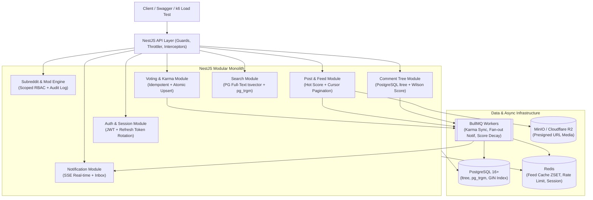
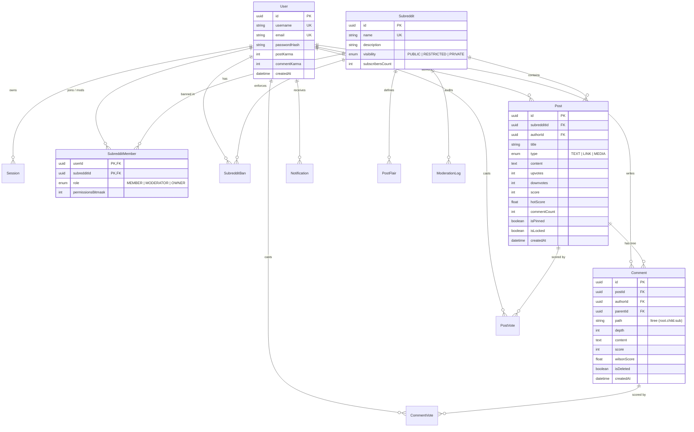

# Kế Hoạch Xây Dựng Reddit Clone Backend API (Chuẩn Production / Portfolio Xin Việc)

> [!IMPORTANT]
> **Mục tiêu cốt lõi:** Nhà tuyển dụng (Tech Lead / Senior Backend) khi nhìn vào repo chỉ mất **30 giây** để phân biệt một đồ án CRUD đại trà với một dự án **Production-Grade**. Thay vì chỉ dừng ở `createPost / getPosts`, dự án này giải quyết **6 bài toán kỹ thuật thực tế của Reddit**: Cây bình luận đa cấp (`ltree`), Thuật toán xếp hạng bài viết (Hot & Wilson Score), Chống Race Condition khi Vote & tính Karma bất đồng bộ, Phân quyền đa tầng theo Subreddit (Scoped RBAC + Audit Log), Cursor Pagination kết hợp Redis ZSET, và Kiểm thử E2E thực tế.

---

## 1. Kiến Trúc Tổng Thể (System Architecture)

Dự án được xây dựng trên nền tảng **NestJS 12**, **Prisma 7.10** và **PostgreSQL 16+**. Thiết kế theo hướng **Modular Monolith + Event-Driven Background Workers**:

---

## 2. 6 Điểm Nhấn Kỹ Thuật Giúp "Ăn Điểm" Khi Phỏng Vấn

### 2.1. Cây Bình Luận Đa Cấp (Nested Comments) với PostgreSQL `ltree`
- **Vấn đề của CRUD thường:** Dùng `parentId` tự tham chiếu và gọi đệ quy trong code hoặc `include: { children: { include: ... } }` gây lỗi **N+1 Query** và không thể phân trang ở nhánh sâu.
- **Giải pháp Production:**
  - Sử dụng extension `ltree` của PostgreSQL lưu đường dẫn dạng `root_id.child_id.grandchild_id` có đánh **GiST Index**.
  - Lấy toàn bộ cây con của 1 bài post hoặc 1 nhánh bất kỳ chỉ bằng **1 câu truy vấn $O(\log N)$** với giới hạn độ sâu (`nlevel(path) <= 6`), các nhánh sâu hơn trả về stub `moreChildrenCount` (giống nút *"Continue this thread"* của Reddit).

### 2.2. Thuật Toán Xếp Hạng (Reddit Hot Ranking & Wilson Score)
- **Bài toán:** Không sắp xếp bài viết đơn thuần bằng `ORDER BY created_at DESC` hay `score DESC` (vì bài cũ nhiều vote sẽ đứng top mãi mãi).
- **Công thức Reddit Hot Score** (lưu precomputed column `hotScore` có đánh B-Tree Index):
  $$\text{Hot}(u, d, t) = \text{sign}(s) \cdot \log_{10}(\max(|s|, 1)) + \frac{t - t_0}{45000}, \quad s = u - d$$
- **Công thức "Best" Comment (Wilson Score Lower Bound 95% confidence):**
  Giúp comment có `10 upvotes / 0 downvotes` xếp trên comment có `100 upvotes / 80 downvotes`:
  $$W(u, n) = \frac{\hat{p} + \frac{z^2}{2n} - z \sqrt{\frac{\hat{p}(1 - \hat{p}) + \frac{z^2}{4n}}{n}}}{1 + \frac{z^2}{n}}, \quad \hat{p} = \frac{u}{n}, \; n = u + d$$

### 2.3. Hệ Thống Vote Chống Race Condition & Tính Karma Bất Đồng Bộ
- **Vấn đề:** User spam click Upvote/Downvote liên tục hoặc nhiều người vote cùng lúc làm lệch `upvotesCount` / `score` và gây lock bảng `User` khi cộng Karma.
- **Giải pháp:**
  - Bảng `PostVote` / `CommentVote` có khóa chính kép `@@id([userId, postId])`.
  - Xử lý chuyển trạng thái vote (`NONE -> UP`, `UP -> DOWN`, `UP -> NONE`) trong **1 câu SQL Transaction/Conditional Update** tính đúng độ lệch $\Delta \in \{-2, -1, +1, +2\}$.
  - Đẩy sự kiện `vote.changed` vào **BullMQ** để cập nhật **User Karma** và làm mới `hotScore` theo batch (Write-Behind pattern), giảm tải lock trên bảng `User`.

### 2.4. Phân Quyền Đa Tầng Theo Subreddit (Scoped RBAC & Mod Audit Log)
- Một user có thể là **Member** ở `r/nestjs`, là **Moderator (chỉ có quyền xóa bài)** ở `r/typescript`, và bị **Banned** ở `r/golang`.
- Thiết kế Custom Guard + Decorator `@RequireSubredditPermission(ModPermission.MANAGE_POSTS)` kết hợp Redis cache cho membership/ban status.
- Mọi hành động của Mod (Pin, Lock, Remove Post, Ban User, Mute User) đều ghi vào bảng `ModerationLog` (bất biến - phục vụ minh bạch & audit).

### 2.5. Cursor-Based Pagination (Keyset) & Personalized Home Feed
- Thay thế hoàn toàn `OFFSET / LIMIT` (bị chậm cấp số nhân khi trượt xuống trang sâu) bằng **Composite Cursor** `(hotScore, id)` hoặc `(createdAt, id)`.
- **Home Feed:** Kết hợp danh sách Subreddit mà User đã join + Redis Sorted Set (`ZSET`) cache các bài viết đang hot.

### 2.6. Bảo Mật & Vận Hành Chuẩn Production
- **Auth:** Access Token (15 phút) + **Refresh Token Rotation & Reuse Detection** (lưu hash của Refresh Token theo từng thiết bị; nếu token cũ bị dùng lại -> lập tức thu hồi toàn bộ token family của thiết bị đó).
- **Upload file an toàn:** Không đẩy file trực tiếp qua server NestJS gây nghẽn RAM; sử dụng **Presigned URL (S3 / Cloudflare R2 / MinIO)**.
- **Observability:** Structured JSON Logging (`nestjs-pino`), Health check (`/health` kiểm tra DB + Redis), Rate Limiting theo IP/User (`@nestjs/throttler`), và sẵn sàng kết nối **NestJS Observe**.

---

## 3. Thiết Kế Database Schema Cốt Lõi (ERD)

---

## 4. Lộ Trình Triển Khai Theo 6 Giai Đoạn (Step-by-Step Roadmap)

### Giai đoạn 1: Nền tảng Hạ tầng & Core Architecture (Tuần 1)
- [ ] Cấu hình `docker-compose.yml` gồm **PostgreSQL 16** (bật sẵn `ltree`, `pg_trgm`), **Redis 7**, và **MinIO** (giả lập S3 ở local).
- [ ] Thiết lập Prisma 7 với `@prisma/adapter-pg` cho schema, viết custom migration kích hoạt extension `CREATE EXTENSION IF NOT EXISTS ltree; CREATE EXTENSION IF NOT EXISTS pg_trgm;`.
- [ ] Xây dựng bộ khung chuẩn Production trong `src/common/`:
  - Biến môi trường typed & validated (`@nestjs/config` + Zod/Joi).
  - Global Exception Filter chuẩn **RFC 7807 Problem Details** (trả lỗi đồng nhất dễ debug).
  - Global ValidationPipe, Serialization Interceptor, Request ID Correlation, Swagger OpenAPI.

### Giai đoạn 2: Authentication, Quản lý Phiên (Session) & User Profile (Tuần 1 - 2)
- [ ] Đăng ký / Đăng nhập với `argon2` hoặc `bcrypt`.
- [ ] **Refresh Token Rotation + Reuse Detection**: Hỗ trợ quản lý nhiều thiết bị (`GET /auth/sessions`, `DELETE /auth/sessions/:id` để đăng xuất từ xa).
- [ ] Decorator `@CurrentUser()` và `@Public()` kết hợp `JwtAuthGuard` (hỗ trợ cả Optional Auth khi khách vãng lai xem bài post hoặc user đã đăng nhập xem bài kèm trạng thái `myVote`).
- [ ] API User Profile (`GET /users/:username/overview`, danh sách bài đã đăng, bình luận, danh sách bài đã `Saved/Bookmarked`).

### Giai đoạn 3: Subreddit Engine & Hệ thống Moderation RBAC (Tuần 2)
- [ ] Tạo Subreddit, cấu hình quyền riêng tư (`PUBLIC`, `RESTRICTED`, `PRIVATE`), quản lý Post Flairs & Subreddit Rules.
- [ ] Join / Leave Subreddit (cập nhật `subscribersCount` an toàn).
- [ ] Xây dựng **Subreddit Permission Guard**:
  - Phân quyền Moderator theo Bitmask (`MANAGE_POSTS`, `BAN_USERS`, `MANAGE_FLAIRS`, `MANAGE_SETTINGS`).
  - Hệ thống Ban / Mute User có thời hạn (`expiresAt`) + lý do.
  - Ghi **Moderation Audit Log** tự động bằng NestJS Interceptor/Event cho mọi thao tác của Mod.

### Giai đoạn 4: Post, Voting Engine & Feed Ranking (Tuần 3)
- [ ] Tạo Post (`TEXT`, `LINK`, `MEDIA` qua Presigned URL), hỗ trợ chỉnh sửa, xóa mềm (Soft Delete: giữ cấu trúc comment bên dưới, hiển thị `[deleted]`), Pin, Lock, NSFW/Spoiler flag.
- [ ] **Atomic Voting Engine**: API `PUT /posts/:id/vote` (`value: 1 | -1 | 0`) xử lý idempotent, chống race condition, tính toán ngay `hotScore`.
- [ ] **Cursor-based Feed API**:
  - Hỗ trợ 4 chế độ sort: `hot`, `new`, `top` (theo khung thời gian `day | week | month | year | all`), `controversial`.
  - Tối ưu hóa truy vấn kèm trạng thái `userVote` và `isSaved` của người đang gọi trong 1 lần query.

### Giai đoạn 5: Cây Bình Luận `ltree`, Full-Text Search & Async Queues (Tuần 4)
- [ ] **Comment Tree Engine**:
  - Tạo comment gốc và reply đa cấp, tự động sinh đường dẫn `ltree` và tính toán **Wilson Score**.
  - API lấy cây comment theo `best | top | new | controversial` với giới hạn độ sâu + endpoint mở rộng nhánh con `GET /comments/:id/Thread`.
- [ ] **BullMQ Background Workers**:
  - Worker tính toán lại Karma của User.
  - Worker gửi thông báo bất đồng bộ khi có người reply bài viết/comment hoặc mention `@username`.
- [ ] **Real-time Notifications (SSE)** + Full-Text Search với PostgreSQL `tsvector` & `pg_trgm` (tìm kiếm Subreddit, Post theo từ khóa + filter theo Subreddit/Flair).

### Giai đoạn 6: Testing, Benchmark & Đóng Gói Portfolio (Tuần 5)
- [ ] **Unit Tests:** Test thuật toán Hot Score, Wilson Score, Bitmask Permission, Refresh Token Reuse Detection.
- [ ] **E2E Tests (Testcontainers / Docker DB):** Test luồng đăng ký -> tạo Subreddit -> đăng bài -> nhiều user cùng vote đồng thời (`Promise.all`) để chứng minh không bị lệch điểm -> phân quyền Mod ban user.
- [ ] **Seed Script (`prisma/seed.ts`):** Tạo sẵn dữ liệu mẫu phong phú (5 subreddits, 50 users, 200 posts, 1,000 nested comments) để nhà tuyển dụng chạy 1 lệnh là trải nghiệm được ngay.
- [ ] **Load Test & README Đỉnh Cao:** Chạy script `k6` đo tốc độ API Feed & Comment Tree, chụp kết quả p95 latency (< 30ms) kèm sơ đồ kiến trúc đưa vào `README.md`.

---

## 5. Cách Trình Bày Dự Án Này Trong CV Để Nổi Bật

Khi hoàn thành, bạn có thể đưa vào CV các gạch đầu dòng (Bullet Points) định lượng rõ ràng như sau:
1. *Thiết kế và xây dựng hệ thống Reddit Clone Backend với **NestJS, Prisma 7, PostgreSQL và Redis**, xử lý phân cấp quyền hạn đa tầng (Multi-tenant RBAC) cho từng cộng đồng (Subreddit).*
2. *Tối ưu hóa truy vấn cây bình luận đa cấp bằng **PostgreSQL `ltree` (Materialized Path)** và GiST Index, loại bỏ hoàn toàn lỗi N+1 query và giảm thời gian tải nhánh bình luận xuống $O(\log N)$.*
3. *Triển khai thuật toán xếp hạng **Reddit Hot Score** và **Wilson Score Confidence Interval** kết hợp **Keyset Cursor Pagination**, giữ độ trễ phản hồi (p95) ổn định khi phân trang dữ liệu lớn.*
4. *Đảm bảo tính toàn vẹn dữ liệu dưới tải đồng thời cao cho hệ thống Upvote/Downvote bằng **Atomic Conditional Updates** và đồng bộ Karma/Notification bất đồng bộ qua **BullMQ**.*
